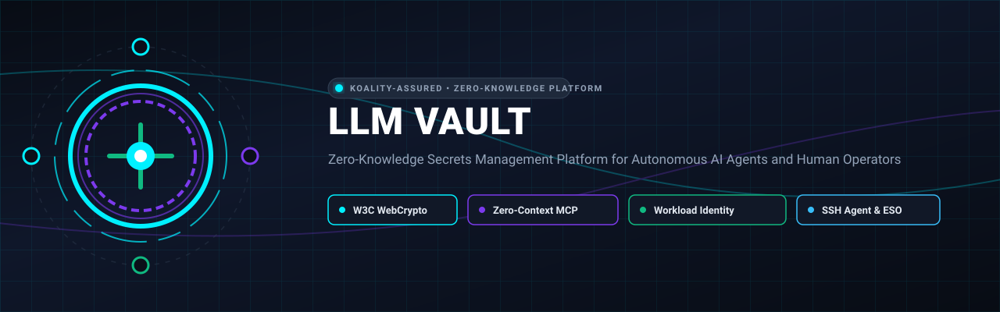
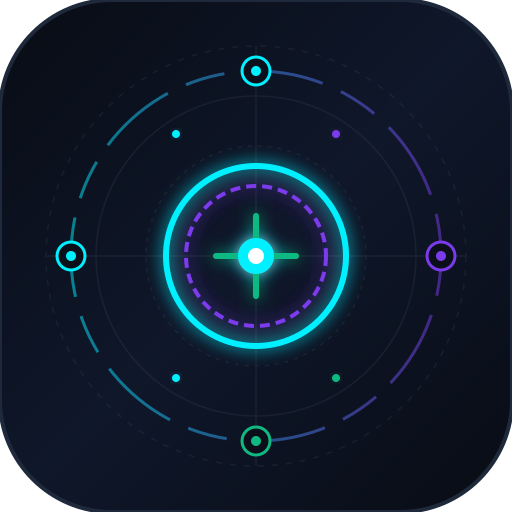

<div align="center">



# LLM Vault

<p align="center">
  
</p>

**Zero-Knowledge Secrets Management Platform for Autonomous AI Agents and Human Operators**

[](https://github.com/Koality-Assured/llm-vault/actions/workflows/ci.yml)
[](LICENSE)
[](https://nodejs.org/)
[](https://www.typescriptlang.org/)
[](#cryptographic-design)
[](<>)
[](https://conventionalcommits.org)

</div>

---

Zero-knowledge secrets management platform for autonomous AI coding agents and human operators.
`llm-vault` pairs client-side W3C WebCrypto envelope encryption with deterministic, type-prefixed ULID identifiers (`sec_<ulid>`) and opaque handles (`{{vault:sec_<ulid>}}`, `lease_<ulid>`). Agents discover, inject, and rotate credentials through [`llm-vault-mcp`](https://github.com/Koality-Assured/llm-vault-mcp) without exposing plaintext secret values to LLM context windows, chat transcripts, or model provider telemetry.

## Architecture

The platform separates cryptographic key ownership from storage and supports two deployment modes controlled by `DEPLOYMENT_MODE`:

- **`DEPLOYMENT_MODE=enterprise`**: Multi-tenant server backed by PostgreSQL, SAML 2.0 / OIDC authentication, client-side Vault Passphrase or WebAuthn PRF Passkey unlock, dual-control organizational recovery escrow, RBAC with cryptographic `SecretReader` withholding, and hash-chained audit logging.
- **`DEPLOYMENT_MODE=standalone`**: Single-user local workstation mode backed by embedded SQLite (`~/.llm-vault/vault.db`), `ClientAuthKey` authentication verified against server-side `Argon2id`, and local `stdio` or Unix socket MCP connectivity.

### Cryptographic Design

All encryption and decryption executes locally in the browser (`window.crypto.subtle`) or inside the MCP server process (`globalThis.crypto.subtle`):

1. **Master Key Stretching & Subkey Separation**:
   - Stretches the user's passphrase with a 32-byte salt via `PBKDF2-HMAC-SHA256` (minimum 600,000 iterations) or WASM `Argon2id` (`memoryKiB: 65536`, `iterations: 3`, `parallelism: 4`).
   - Expands master key material via `HKDF-SHA256` into domain-separated subkeys:
     - `MasterEncryptionKey` (`info = "llm-vault/v1/master-encryption-key"`): non-extractable 256-bit `AES-GCM` `CryptoKey` used to wrap user private keys and vault keys.
     - `ClientAuthKey` (`info = "llm-vault/v1/client-auth-key"`): 256-bit authentication token used in `standalone` mode.
2. **Envelope Encryption with Canonical AAD**:
   - Each vault uses an independent 256-bit `AES-GCM` `VaultKey`.
   - Every secret metadata and payload encryption call generates a fresh 96-bit random IV, produces a 128-bit authentication tag, and binds canonical Additional Authenticated Data:
     ```text
     UTF8("${tenantId}:${vaultId}:${secretId}:${version}:${keyVersion}")
     ```
   - Binding tenant, vault, item ID, secret version, and vault key version into AAD prevents ciphertext transplantation or version rollback tampering if the database is compromised.
3. **Asymmetric Key Hierarchy & Agent Delegation**:
   - Users hold `X25519` key-agreement and `Ed25519` signing keypairs whose private keys are wrapped client-side under `MasterEncryptionKey`.
   - Shared vault access wraps `VaultKey` per recipient using `X25519` shared secret derivation (`HKDF-SHA256`) and `AES-256-GCM`.
   - Autonomous agents (`agt_<ulid>`) receive a scoped `AgentEncryptedVaultKey` unwrapped locally by `llm-vault-mcp` using an OS-keychain-resident `AgentDecryptionKey`.
4. **Blind-Indexed Tags & Tamper-Evident Audit Chains**:
   - Searchable tags are indexed using keyed `HMAC-SHA256` blind indexes derived from a vault-specific `VaultSearchKey` (`info = "llm-vault/v1/vault-search-key"`).
   - Audit records (`aud_<ulid>`) chain each event hash over `prev_event_hash || canonical_json(event)` via `HMAC-SHA256` and optional `Ed25519` signatures.

## Monorepo Packages

| Package             | Path              | Description                                                                                                                                                                                                                                  |
| ------------------- | ----------------- | -------------------------------------------------------------------------------------------------------------------------------------------------------------------------------------------------------------------------------------------- |
| `@llm-vault/ids`    | `packages/ids`    | Cryptographically random, Crockford Base32, millisecond-sortable ULID generator and parser for `sec_`, `vlt_`, `fld_`, `usr_`, `agt_`, `lease_`, and `aud_` identifiers plus `{{vault:sec_...}}` handle helpers.                             |
| `@llm-vault/crypto` | `packages/crypto` | W3C WebCrypto engine implementing `PBKDF2` / `Argon2id` stretching, `HKDF-SHA256` subkey derivation, `AES-256-GCM` with canonical AAD, `X25519` / `Ed25519` key wrapping, blind indexing, audit hash chaining, and `Uint8Array` zeroization. |
| `@llm-vault/schema` | `packages/schema` | Shared Zod schemas, RBAC roles and permission scopes, API contracts, and Drizzle ORM table definitions for PostgreSQL (`@llm-vault/schema/db/postgres`) and SQLite (`@llm-vault/schema/db/sqlite`).                                          |

## Development

Requires Node.js `>=22` (tested on Node.js 24 LTS).

```bash
npm install
npm run typecheck
npm run lint
npm run format:check
npm test
```

## License

MIT — see [LICENSE](./LICENSE).
